 

I make themes and visual mods for desktop apps. Mostly small, mostly JavaScript, mostly because the default looked boring.

 

### Work

**[antigravity-ascii-wallpapers](https://github.com/erlttt0/antigravity-ascii-wallpapers)**
23 live, animated ASCII-art wallpapers for the Antigravity desktop app. Unofficial mod.

**[antigravity-gemini-theme](https://github.com/erlttt0/antigravity-gemini-theme)**
A Gemini-inspired dark theme for Antigravity, with a Windows installer you can fully undo.

 

### Principles

- Reversible installs. If it can't be uninstalled cleanly, it isn't done.
- No build step where a single file will do.
- Ship it small, then fix what people actually hit.

 

### Elsewhere

[Repositories](https://github.com/erlttt0?tab=repositories) · [Stars](https://github.com/erlttt0?tab=stars)

Issues and PRs welcome on any of the above.
